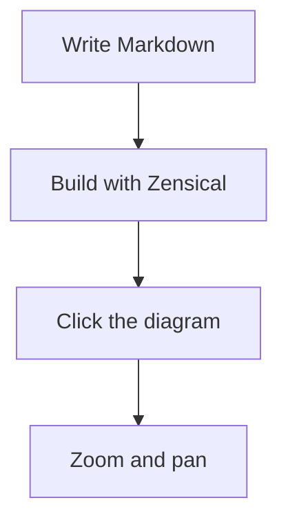
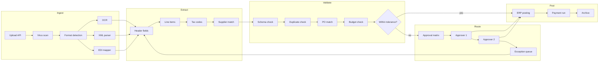
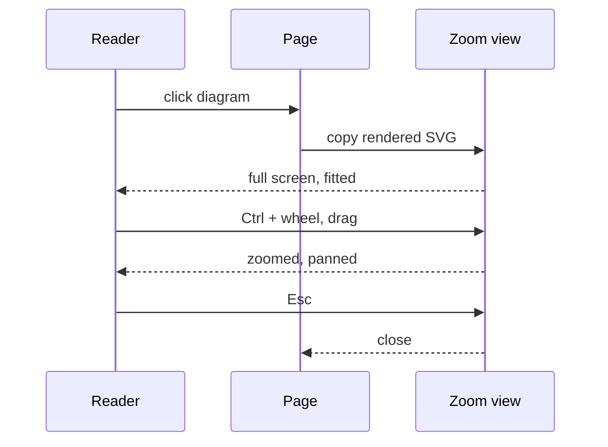

# Reading tools demo

Click a diagram to open it full screen. Zoom with the buttons, `+` / `-` / `0`, or Ctrl + wheel
(trackpad pinch); drag to pan; `Esc` closes. Tables have a **Full screen** button, and the toolbar
toggles the navigation, the table of contents and the full-width layout.

This page is built from [`skills/zensical-publishing`](https://github.com/vivainio/agent-skills/tree/main/skills/zensical-publishing),
which installs the tools into any Zensical book.

## A small diagram

## A large diagram

Too wide to read at column width: this is what the zoom view is for.

## A sequence diagram

## A table

| Control | Action |
|---|---|
| Click | Open the diagram full screen |
| `+` / `-` | Zoom in / out |
| `0` | Fit to window |
| Ctrl + wheel | Zoom around the pointer |
| Drag | Pan |
| `Esc` | Close |
