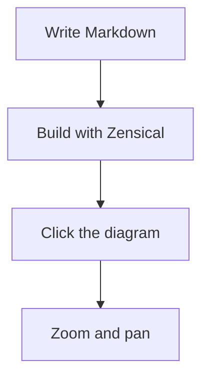
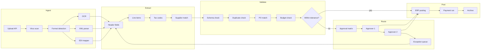
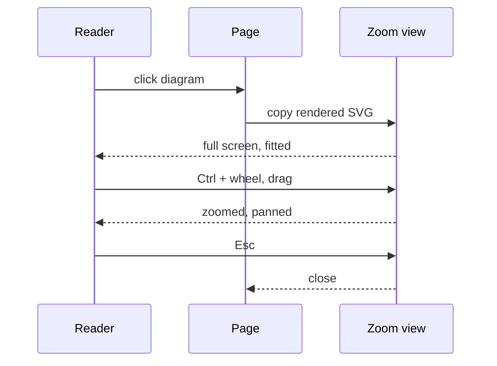
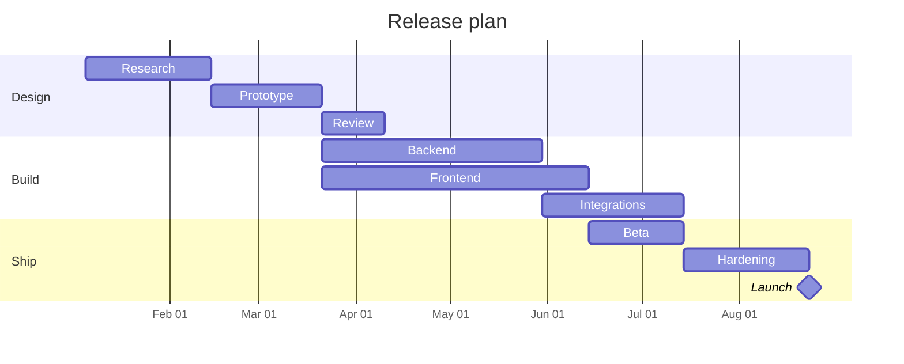

# Reading tools demo

Click a diagram to open it full screen. Zoom with the buttons, `+` / `-` / `0`, or Ctrl + wheel
(trackpad pinch); drag to pan; `Esc` closes. Tables have a **Full screen** button, and the toolbar
toggles the navigation, the table of contents and the full-width layout.

This page is built from [`skills/zensical-publishing`](https://github.com/vivainio/agent-skills/tree/main/skills/zensical-publishing),
which installs the tools into any Zensical book.

## A small diagram

## A large diagram

Too wide to read at column width: this is what the zoom view is for.

## A sequence diagram

## A very wide diagram (pan sideways)

A 30-step chain, about eight times wider than tall. Open it, zoom in with `+`, then drag sideways.

```mermaid
flowchart LR
    S1[Step 1] --> S2[Step 2] --> S3[Step 3] --> S4[Step 4] --> S5[Step 5] --> S6[Step 6] --> S7[Step 7] --> S8[Step 8] --> S9[Step 9] --> S10[Step 10] --> S11[Step 11] --> S12[Step 12] --> S13[Step 13] --> S14[Step 14] --> S15[Step 15] --> S16[Step 16] --> S17[Step 17] --> S18[Step 18] --> S19[Step 19] --> S20[Step 20] --> S21[Step 21] --> S22[Step 22] --> S23[Step 23] --> S24[Step 24] --> S25[Step 25] --> S26[Step 26] --> S27[Step 27] --> S28[Step 28] --> S29[Step 29] --> S30[Step 30]
```

## A wide timeline

## A wide table

22 columns: use **Full screen**, then scroll sideways.

| Region | Q1 | Q2 | Q3 | Q4 | Jan | Feb | Mar | Apr | May | Jun | Jul | Aug | Sep | Oct | Nov | Dec | Total | Target | Delta | Owner | Notes |
|---|---|---|---|---|---|---|---|---|---|---|---|---|---|---|---|---|---|---|---|---|---|
| North | 12 | 14 | 11 | 18 | 3 | 4 | 5 | 6 | 7 | 8 | 9 | 10 | 11 | 12 | 13 | 14 | 55 | 50 | +5 | Anna | On track |
| South | 9 | 10 | 13 | 12 | 1 | 2 | 3 | 4 | 5 | 6 | 7 | 8 | 9 | 10 | 11 | 12 | 44 | 50 | -6 | Ben | Behind |
| East | 15 | 16 | 17 | 20 | 5 | 6 | 7 | 8 | 9 | 10 | 11 | 12 | 13 | 14 | 15 | 16 | 68 | 60 | +8 | Cara | Ahead |

## A small table

| Control | Action |
|---|---|
| Click | Open the diagram full screen |
| `+` / `-` | Zoom in / out |
| `0` | Fit to window |
| Ctrl + wheel | Zoom around the pointer |
| Drag | Pan |
| `Esc` | Close |
